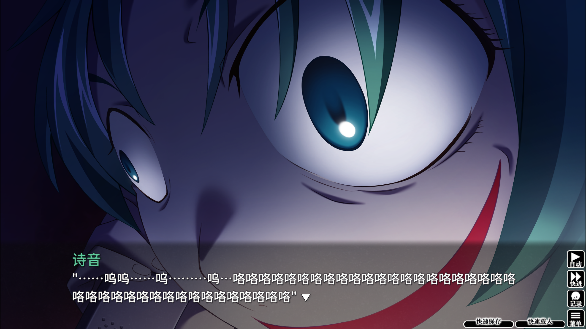
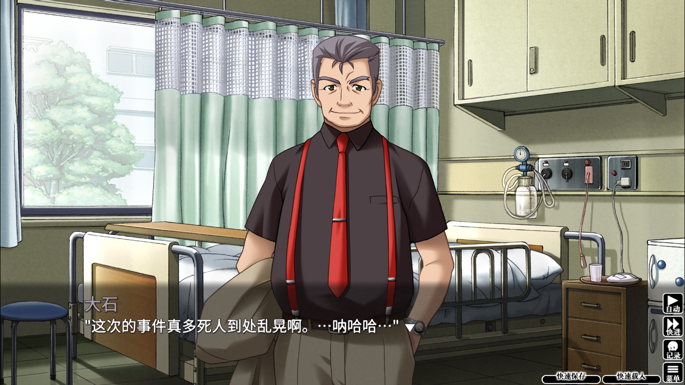

终于玩到寒蝉第二篇了，跟第一篇差不多，绵流篇也是从第六章开始，剧情才逐渐开始悬疑起来的，然后又是多重的剧情反转，推完后我整个人都惊了，居然是这样吗？非常好奇【解】的时候要怎么圆回来

然后我也注意到了第二篇的一个叙事技巧，我姑且称之为misdirection

最初我们遇到诗音的时候，是圭一和老爸去吃甜品的时候，因为诗音和魅音非常像，游戏之前从来没有交代过魅音有一个双胞胎妹妹，并且龙宫蕾娜、北条沙都子和古手梨花都不知道有这个双胞胎妹妹，因此我们一开始和圭一一样，认为诗音就是魅音，并且是展示了女性力的魅音。这是游戏埋的第一个misdirection

再接着，由于故事开篇的社团活动中，圭一没有把玩偶给魅音，这伤害到了魅音，而圭一浑然不觉，直到蕾娜提醒了之后，圭一才意识到这点不对，于是故事就有点开始往诗音和圭一的恋爱线推进了，直到诗音和魅音同台出现在玩具店中，这才清楚诗音和魅音确实是两个人，是双胞胎

在故事澄清了双胞胎这一设定之后，我们自然而然就把诗音和魅音完全区分开了，这是游戏埋的第二个misdirection，以至于在绵流仪式之后，我们虽然没有见过诗音，但是始终坚信晚上跟我们通话的就是诗音，不论是情绪还是口吻，都像是诗音。直到绵流仪式的第三天，大石跟圭一提到“诗音在绵流仪式第二天就失踪了”，然后讲述了“村长”失踪的情况（在绵流仪式的第二天，村长很早就去市里看痔疮了，因为各种原因，耽搁了很久，晚上一回到雏见泽就去开会了，然后在会后回去的路上失踪的，并且没有人知道村长去市里这件事），而昨天和诗音通话时，她说“因为自己把闯进祭具殿的事跟村长说了之后，才会让村长出事的”，稍微推理一下就知道，诗音根本没有机会和村长说这件事。因此晚上等“诗音”再打电话过来的时候，圭一把这段推理和电话那头说了一遍，哭声突然变成了狂笑，这才知道原来这几天一直是在和魅音通话

再后来，先是跟蕾娜一起去魅音家谈话，然后是圭一和魅音去地下室两人独处，在这里发现了精神已经异常的诗音（这是游戏埋的第三个misdirection），警察闯入要逮捕魅音，魅音往通道逃跑，……。经过种种之后，诗音最后进了一个私人精神医院，而魅音已经下落不明。直到有一天晚上，魅音突然到圭一家楼下把圭一捅了，好像又去诗音那里逼得诗音跳楼自杀了。圭一在医院养了一段时间伤之后，大石突然到访，提到“在地下室的井里面，发现了已经死掉的魅音，根据验尸结果，她是警察闯入逃跑的那天，由于向上爬出通道时不慎摔落，在井里面摔死的，并且头部骨折的地方和诗音跳楼时骨折的地方一致”。那么那天晚上来找圭一的到底是谁？拿刀捅圭一的又是谁？也许只能是诗音了吧（毕竟前面几章也提到过诗音有不错的演技），但是人可能是诗音，而实质上控制诗音头脑的则是鬼，就跟魅音一样。

> 毕竟是双胞胎，两人都有鬼的血脉，只要体内的鬼被唤醒，就不难做出一致的吃人行为吧

不过这还不是最让我吃惊的，大石又提到“根据尸检，鹰野三四早在绵流仪式前几天就已经身亡了”，那么当初带圭一他们一起进祭具殿的“鹰野三四”又是谁？如果当初在绵流仪式的晚上，“鹰野三四”没有让几个人进祭具殿的话，就不会有人死掉，可以说是本篇的罪魁祸首了，但是竟然？

‍既是游戏的misdirection，又是留下的两个谜题，😀太刺激了

‍